# VOLT — Next.js Padel & Squash Club Booking Template

A production-ready booking website for padel & squash clubs. Built with **Next.js 15**, **Tailwind CSS v4**, and the **Opencals Storefront SDK**.

**[View Live Demo →](https://template-volt.vercel.app)**

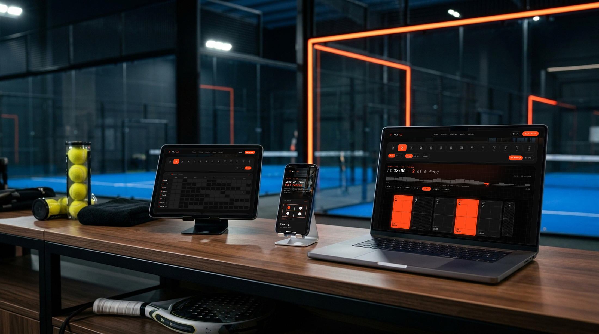

A dark, technical club aesthetic — near-black surfaces, electric-orange accent, and a monospace display face — for a **multi-club network**: a club-first, full-screen **court booking page** (a live hall map of every court, or a courts × time grid) for rentals, and a classic **coach-led training flow** for lessons and group classes. Full storefront included — courts, trainings, coaches, checkout, customer accounts — wired up out of the box. MIT licensed: clone it, rebrand it, ship it.

---

## Get Started in 3 Steps

### 1. Create an Opencals account

Sign up at **[app.opencals.com](https://app.opencals.com)** and create a **Dev Store**. When prompted for a dataset, choose the **VOLT Padel & Squash** preset — this seeds your store with four clubs (Madrid, Barcelona, Valencia, Málaga), their padel doubles, padel singles and squash courts, coaches, training classes and add-ons, so your template looks exactly like the demo.

### 2. Get your API key

Go to your **User Account Settings** in the Opencals dashboard and generate a **Storefront API key**. You'll need this to connect the template to your store.

### 3. Deploy to Vercel

[](https://vercel.com/new/clone?repository-url=https%3A%2F%2Fgithub.com%2Fletsopencals%2Ftemplate-volt&env=OPENCALS_API_KEY,AUTH_SECRET&envDescription=API%20key%20from%20your%20Opencals%20dashboard%20and%20a%20random%20secret%20for%20auth&project-name=volt&repository-name=template-volt)

During deployment, Vercel will ask you to set environment variables:

| Variable | Value |
|----------|-------|
| `OPENCALS_API_KEY` | Your Storefront API key (starts with `sfk_`) |
| `AUTH_SECRET` | Any random string — used for session encryption |
| `NEXT_PUBLIC_STRIPE_PUBLISHABLE_KEY` | *(optional)* Stripe publishable key for payments |

That's it. Once deployed, you'll have the same fully functional booking site as the [live demo](https://template-volt.vercel.app).

---

## The Storefront

A full-bleed, cinematic homepage with an "Our clubs" section (one card per club, straight into its courts), a two-mode intro (rent a court vs. train with a coach), sports with live court counts, a coaches teaser and a facility gallery, all driven by your Opencals data.

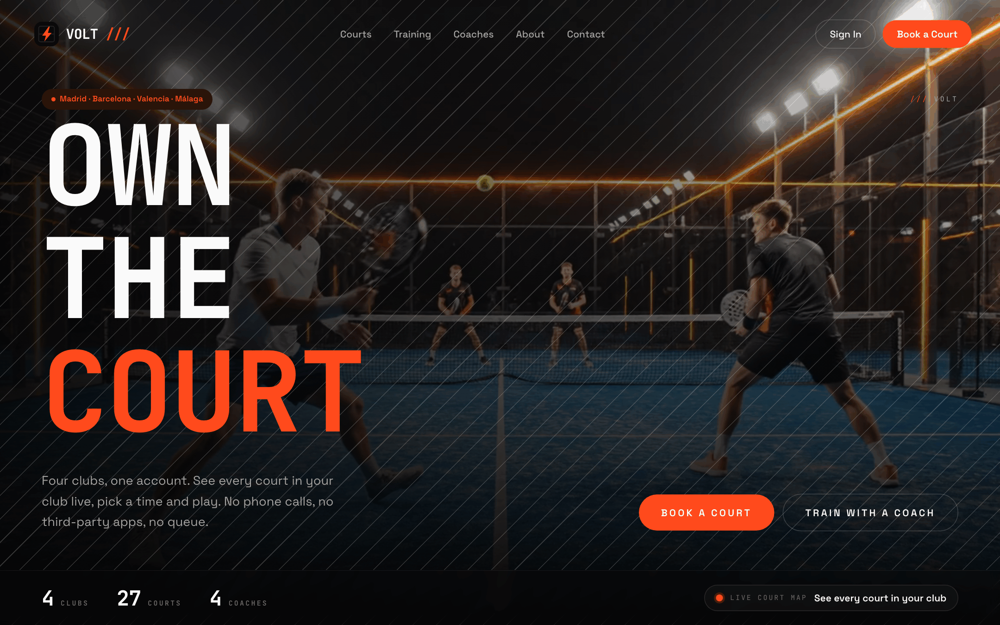

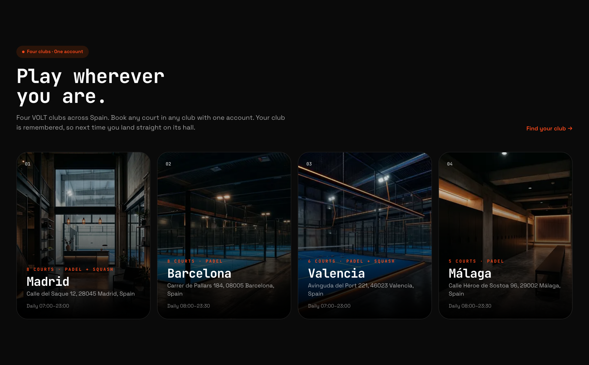

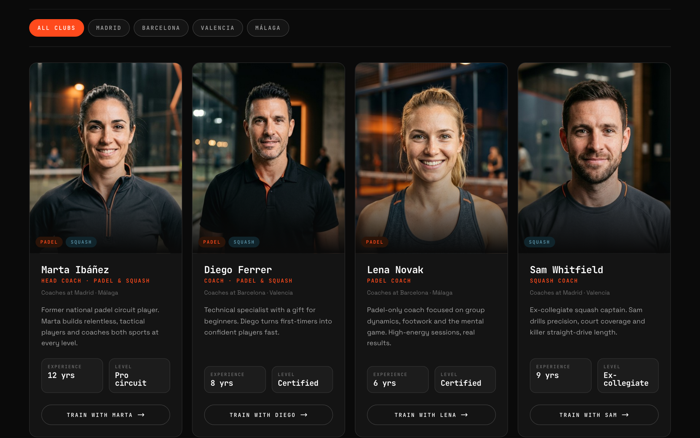

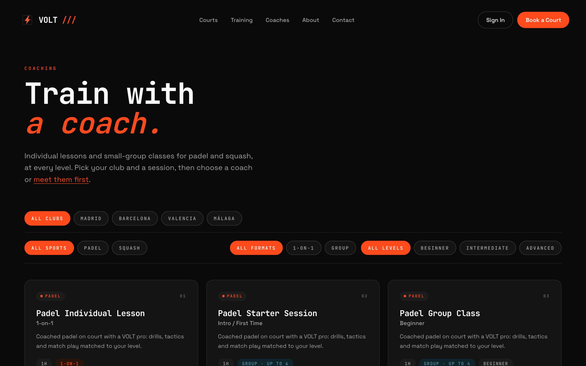

---

## What's Included

### Club-First Court Booking

The centerpiece, full screen. Players don't look for a court in four cities at once, so `/book` starts from **one club**: the one in the link, the one this browser remembers, or the nearest one ("Near me" uses the club coordinates from your store). New visitors pick from photo cards that show each club's soonest free court. The club's page then has two views over the same live data:

- **Hall map.** Every court from above, doubles wide and singles narrow, lit for one start time: orange = free for the whole game, a pulsing edge = free within the hour, dim = free later ("from 21:00"), hatched = taken for the day. Drag the time bar (its bars are the number of free courts per half hour) or tap a quick time; "Book 19:30" takes the best free court in one tap, and tapping a court lists its own free starts.
- **Grid.** Courts × half hours for the day, with a now-line. Tap a free cell, pick 30 / 60 / 90 / 120 minutes (hovering previews the spanned cells), confirm.

Pick a day (14 days ahead, sold-out days struck through), a sport (only the club's sports show) and a game length. Everything is in the URL (`/book?club=volt-madrid&sport=padel&date=…&length=90&time=19:30&view=grid`), so links to a club, a day or a time just work.

**Fast by design.** The page makes **one request per club**: `/api/clubs/[id]/availability` reads each court's free ranges for the whole booking window once (merged availability), caches each court for 60 seconds on the server, and the browser computes the map, the grid, the pulse and every "free from" locally. Switching day, length, sport or view never calls the API. A booking, cancel or reschedule invalidates the cached courts at once.

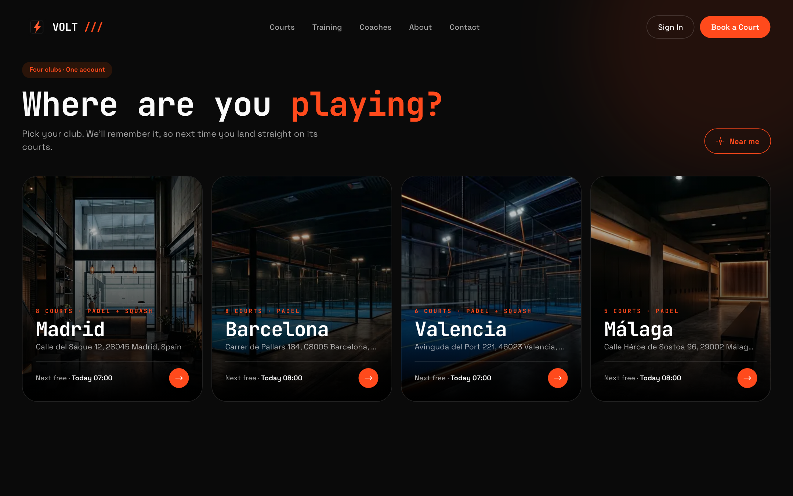

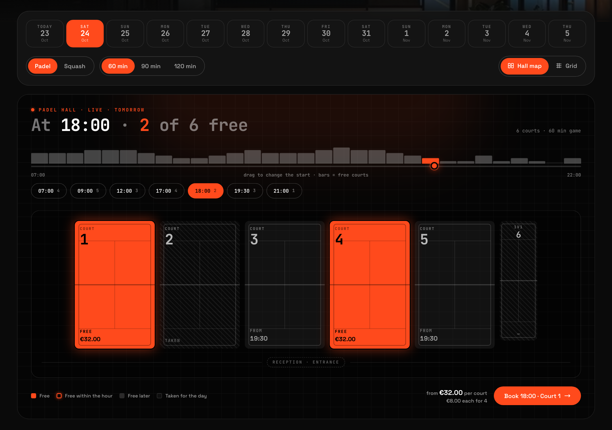

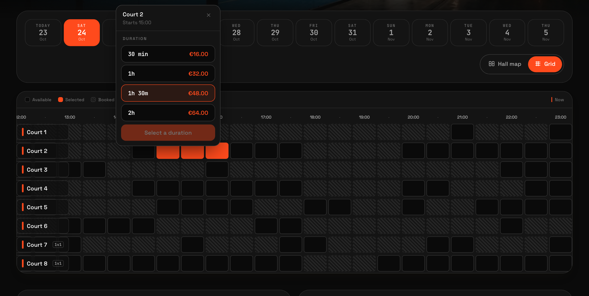

### Multi-Club Model (store conventions)

- **Club = store location.** Title, address, coordinates and timezone come from the location (and its courts' schedule). Photos, a tagline, hours and a phone number per club live in `siteConfig.clubs.presentation`, matched by location slug or city.
- **Court = one product variant**, assigned to exactly one club, in a court collection (`padel-courts`, `squash-courts`). Give each court `allowCustomDuration` with a 30-minute base and a 2-hour maximum. Each court is its own resource, so booking one court leaves the others free.
- **Format from the variant title.** `Court 7 · Singles` is a singles court (narrow tile, 2 players); anything else is doubles (4 players). Court numbers come from the title too.
- **Sports are config.** `siteConfig.sports` maps a court collection (and a training collection) to a label and colour. Add pickleball by adding an entry and its collections; a club only shows the sports it has courts for.
- **Training and coaches per club.** Training products and coaches are assigned to locations; `/training` and `/coaches` filter by club and default to the remembered one.

### Coach-Led Training

Lessons and classes per club. Browse the training catalog by club, sport, level (Starter → Advanced) and format (individual vs. group), then book: pick the level, club and coach (or **"Any coach"**), a day and a start. Group classes show **live "N left"** places and you can book more than one.

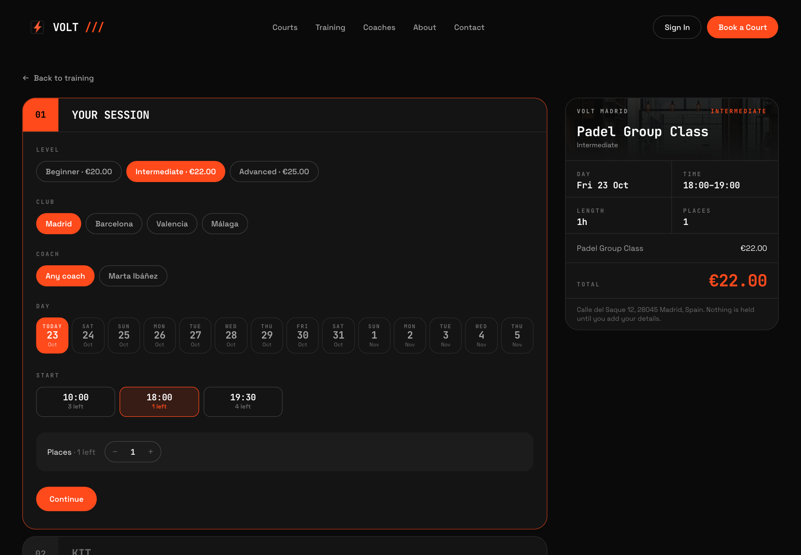

### Two Resource Models, One Store

- **Courts** are staffless resources (the Opencals *Self* rule + `maxAttendees: 1`) — an independent, exclusively-booked unit each.
- **Trainings** are assigned to real **coaches** (the *Staff* rule) and can carry **group capacity** (`maxAttendees > 1`), which drives the "spots left" display.

Bookings read naturally either way: "Padel · Court 3 · 1h 30m" for a rental, "Padel Group Class · Intermediate · Coach Marta" for a class.

### The Game Flow (checkout)

One checkout for courts and training, built like a match sheet: numbered steps that fold up as you go, with a sticky **match card** (court from above, day, time, length, who's on court, running total, hold timer).

- **Courts:** Your court (any court, falling back to the next free one, or exactly the one you tapped) → **Your crew** (up to three players by name; an email invites them, and the card shows each player's share) → **Kit** (your store's add-ons: rackets, balls…) → Your details → Payment.
- **Training:** Your session (level, club, coach, day, start, places) → Kit → Your details → Payment.
- Payment uses your store's providers: card via Stripe Elements, or pay at the club. Auto sign-in after checkout.

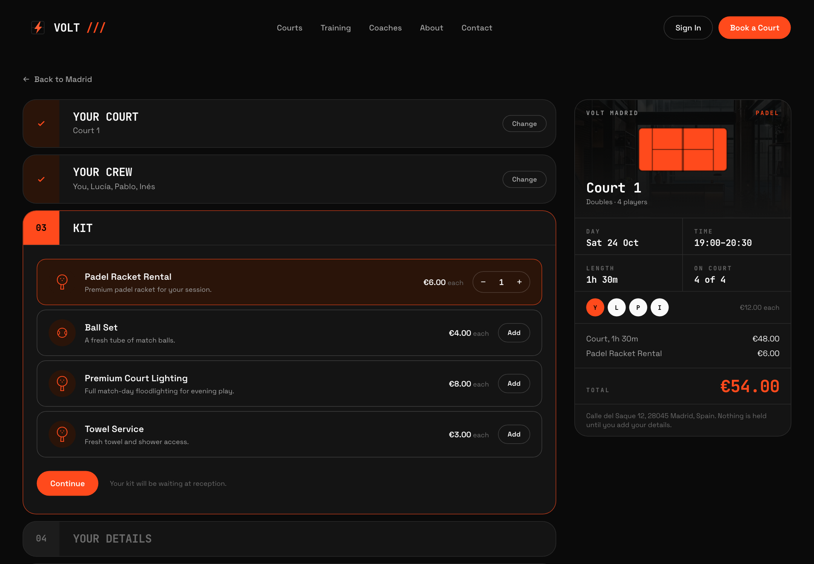

### Match-Ticket Confirmation

`/thank-you` opens on the club photo ("Game on, Sam! / VOLT Madrid") with the **match ticket**: the court from above with a spot per player (doubles, singles or squash), day, time, length, players, booking reference, kit and a live countdown. Then add-to-calendar (.ics), directions, send-to-crew, your crew, "Before you play", "Getting there" (address, hours, map link), the free-cancellation line and **"Same time next week?"**. Guests see it too, from a snapshot of the flow.

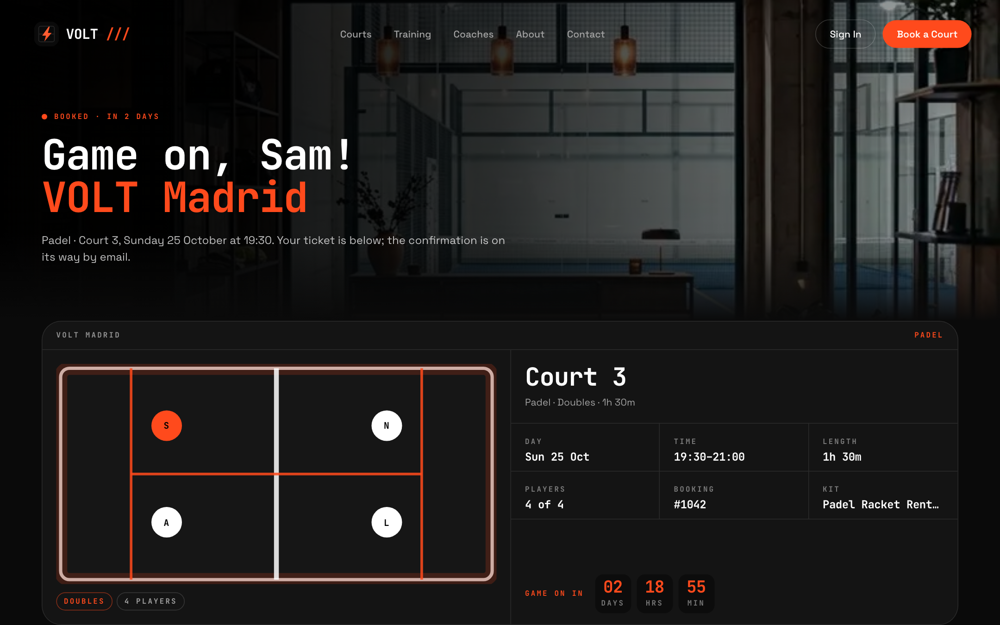

### Customer Accounts

Passwordless sign-in by default: players enter their email and receive a 6-digit login code (password sign-in stays available as a fallback). **My games** shows a stats strip (games played, hours on court, your club, clubs played), the next game as a full ticket, upcoming games and trainings, the players you play with, and past games with **Book again**. Each game can invite more players by email, change time or cancel; orders and details are one tab away.

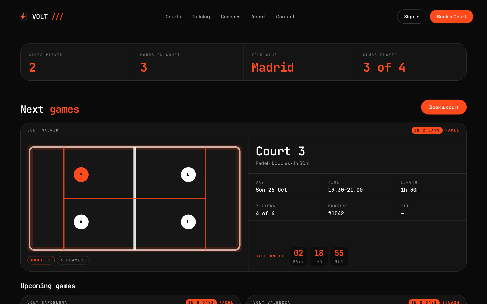

Review every post-booking state without a store at **`/preview/index`** (fixture clubs and games; on in development, or set `VOLT_PREVIEW=1`).

One-time email links from Opencals (view/reschedule/cancel booking, leave feedback, verify email, reset password) all resolve through the `/link/[token]` route, which signs the customer in and redirects them to the right place.

> **Set your Storefront Base URL.** For emailed links to point back to this app, set **Storefront Base URL** in your Opencals dashboard (Settings → API) to your deployed URL (e.g. `https://your-domain.com`). Opencals builds every customer link as `{storefrontBaseUrl}/link/{token}`.

### Cinematic Hero, Video-Ready

The homepage hero is a full-bleed background that upgrades to a looping video automatically when `public/videos/hero.mp4` is present, and falls back to a still image otherwise — zero code changes either way.

### Mobile-First Design

Fully responsive. The hall map reflows its courts to the screen and the grid scrolls horizontally on phones with a sticky court-name column; the training flow is a card-stack that feels native on mobile and expands to two columns on desktop.

<p align="center">
  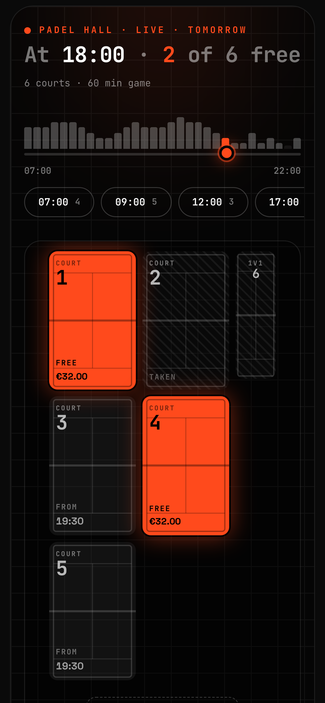
  &nbsp;&nbsp;
  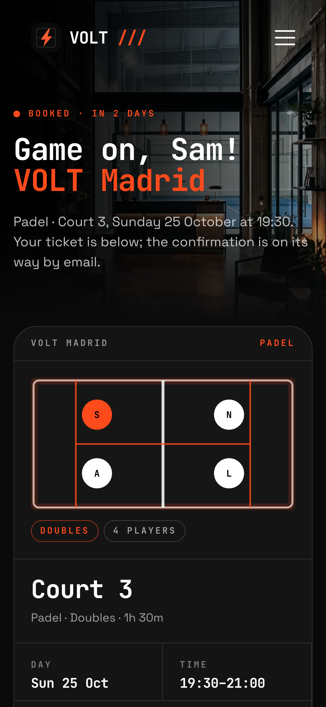
</p>

### SEO Ready

Per-page metadata, Open Graph cards, `SportsActivityLocation` structured data, robots.txt, and sitemap.xml — configured out of the box.

---

## Tech Stack

| Category | Technology |
|----------|-----------|
| Framework | Next.js 15 (App Router) |
| Styling | Tailwind CSS v4 |
| Animations | Framer Motion |
| Forms | react-hook-form + Zod |
| Payments | Stripe Elements |
| Auth | NextAuth.js v5 |
| Dates | moment-timezone |
| API | Opencals Storefront SDK (v0.3.14) |

---

## Local Development

```bash
git clone https://github.com/letsopencals/template-volt.git
cd template-volt
npm install
cp .env.example .env
```

Edit `.env` with your values:

```
OPENCALS_API_KEY=sfk_your_key_here
AUTH_SECRET=change_me_to_a_random_string
```

```bash
npm run dev
```

Open [http://localhost:3000](http://localhost:3000).

---

## Customization

### Branding & Content

All club-specific copy is centralized in **`lib/site-config.ts`**:

- Club name, tagline, logo wordmark
- Sports (labels, colours, price hints, court and training collection slugs)
- Club presentation (photo, tagline, hours, phone per club)
- Homepage hero, "two ways to play" modes, training levels, stats, process steps
- Coaches, gallery, testimonials, FAQs
- About page story, contact information (address, phone, email, hours)
- Footer links and social media

Edit this single file to rebrand the entire template. The bookable data (courts, trainings, coaches, prices, availability) comes from your Opencals store.

### Theme Colors

Design tokens live in **`app/globals.css`** as Tailwind v4 `@theme` properties. Token names are intentionally stable, so components keep working when you change the values:

```css
@theme {
  --color-bg: #0A0A0A;          /* near-black page background */
  --color-surface: #141414;     /* cards / panels */
  --color-ink: #FAFAFA;         /* primary text */
  --color-primary: #FF4A1C;     /* electric-orange accent */
  --font-display: 'JetBrains Mono', ui-monospace, monospace;
  --font-body: 'Space Grotesk', system-ui, sans-serif;
}
```

Tip: keep the accent aligned with your store's storefront primary color so the deployed site matches your Opencals settings.

### Imagery

Drop hero, sport, gallery, coach and club images into `public/images/{hero,sports,gallery,coaches,about}/` (and an optional `public/videos/hero.mp4`). See **`public/images/PLACEHOLDERS.md`** for filenames and recommended dimensions. Court, training and coach photos in the live booking flow come from your Opencals store, not this folder.

### Adding Pages

1. Create `app/your-page/page.tsx`
2. Add a `layout.tsx` with metadata
3. Add the link to `navLinks` in `components/layout/header.tsx`

---

## Project Structure

```
app/
  page.tsx                     # Homepage
  book/page.tsx                # Club-first court booking (hall map | grid)
  training/page.tsx            # Training catalog (filter by club / sport / level / format)
  booking/[slug]/page.tsx      # Training booking (the game flow)
  thank-you/page.tsx           # Match-ticket confirmation
  preview/[screen]/            # Fixture previews of confirmation + account states
  coaches/                     # Meet the coaches
  about/                       # About page
  contact/                     # Contact form + info
  account/                     # Customer dashboard
  auth/                        # Sign in, sign up, password reset
  link/[token]/                # One-time email link resolver
  api/                         # API routes proxy SDK calls server-side
    clubs/[locationId]/availability  # One club's court availability (cached per court)

components/
  layout/{header,footer}.tsx   # Site chrome
  home/                        # Hero, modes, sports, training levels, coaches, gallery, ...
  book/                        # Club chooser, club hero, hall map, toolbar
  booking/                     # Court grid, duration popover, Stripe Elements
  game/                        # Game flow (steps + match card), confirmation, account
  account/                     # Customer dashboard components
  ui/                          # Shared primitives (button, input, ...)

contexts/                      # cart, location, timezone, settings
hooks/                         # use-home-club, use-club-availability, use-club-grid, use-game-booking, use-game-checkout, ...
lib/                           # club (catalogue + availability maths), game (appointment → game), availability-server, server-data,
                               #   site-config, opencals (SDK), auth (NextAuth), schemas, format, utils
```

## Environment Variables

| Variable | Required | Description |
|----------|----------|-------------|
| `OPENCALS_API_KEY` | Yes | Storefront API key from your Opencals dashboard |
| `AUTH_SECRET` | Yes | Random string for NextAuth session encryption |
| `NEXT_PUBLIC_STRIPE_PUBLISHABLE_KEY` | No | Stripe publishable key; fallback when the API doesn't return one with checkout |
| `OPENCALS_API_URL` | No | Override API base URL (defaults to production) |
| `NEXT_PUBLIC_BASE_URL` | No | Public site URL (for sitemap) |
| `VOLT_PREVIEW` | No | `1` serves `/preview/[screen]` in production (always on in development) |

---

## Other Templates

VOLT is one of the open-source booking templates built on the Opencals Storefront SDK. Same backend, different design and vertical:

- **[Clear Care](https://github.com/letsopencals/template-clarity)** — a medical clinic template with department-first booking. [Live demo](https://template-clarity.vercel.app)
- **[Frisor](https://github.com/letsopencals/template-frisor)** — a modern barbershop template with a dark editorial palette. [Live demo](https://template-frisor-sage.vercel.app)
- **[HAAR](https://github.com/letsopencals/template-haar)** — a hair-salon booking template with a light, warm palette. [Live demo](https://template-haar.vercel.app)
- **[NOIR Drive](https://github.com/letsopencals/template-noir)** — a luxury car-rental template (Dubai) with multi-day booking by the day and chauffeur packages. [Live demo](https://template-noir.vercel.app)
- **[Fluently](https://github.com/letsopencals/template-fluently)** — a language-school template (New York) with group classes, live seats, private lessons and online lessons. [Live demo](https://template-fluently.vercel.app)
- **[Bali Villa Rentals](https://github.com/letsopencals/template-bali-villas)** — a villa-rental template (Bali, demo brand Lumbung Sidemen) with nightly stays and fixed check-in and check-out. [Live demo](https://template-bali-villas.vercel.app)
- **[Tensile](https://github.com/letsopencals/template-reformer)** — a reformer Pilates studio template (Berlin) with a multi-studio class timetable, beds left, privates and workshops. [Live demo](https://template-reformer.vercel.app)

See all templates and the Storefront API at **[opencals.com/developers](https://opencals.com/developers)**.

## Build with AI

Prefer to let an AI agent do the heavy lifting? Install the **[Opencals Agent Skills](https://github.com/letsopencals/skills)** in Claude Code, Cursor, Codex or Gemini CLI:

- **`opencals-build-booking-site`** — scaffold, wire and deploy a template like this one
- **`opencals-storefront-api`** — ground-truth reference for the Opencals API & SDK

Docs: **[opencals.com/docs → AI Agents](https://opencals.com/docs/ai-agents/overview)**.

## License

MIT
